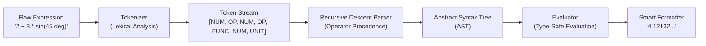
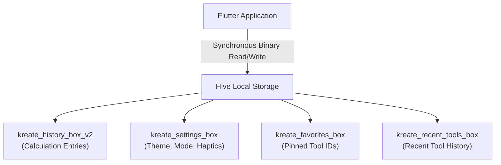

# Calculator — System Architecture

This document provides a comprehensive technical overview of the software architecture, design patterns, state management, mathematical parsing pipeline, and data storage mechanisms utilized in **Calculator**.

---

## 🏛️ Architectural Overview

Calculator is built using **Flutter (Dart 3.13+)** and adheres strictly to a **Feature-First Clean Architecture** pattern. This structure decouples mathematical computation engines from presentation widgets, enabling exhaustive unit testing without widget tree instantiation.

```text
lib/
├── app/
│   ├── router/          # Declarative URL navigation & deep-linking (go_router)
│   └── theme/           # Design system tokens, color matrices & typography (KTheme)
├── core/
│   ├── constants/       # Immutable geometry (KSpacing, KRadius, KColors, KreateLinks)
│   ├── services/        # Platform abstraction services (KreateLogger, FeedbackService)
│   ├── theme/           # Dynamic semantic theme extensions (context.kPalette)
│   ├── utils/           # Web URL query state serialization (WebStateSerializer)
│   └── widgets/         # Reusable atomic UI components (Buttons, GlassCards, MatrixEditors)
└── features/
    ├── calculator/      # Core arithmetic workspace, AST math engine & interactive keypad
    ├── history/         # Hive binary local storage for calculation logs & undo/redo
    ├── favorites/       # Fast-access pinned tool repository
    ├── settings/        # Theme mode, palette selection, and haptic preferences
    ├── share/           # High-DPI canvas rasterization & image export service
    └── tools/           # 150 specialized mathematical, scientific & calculation tools:
        ├── chemistry/   # Gas laws, molar mass, stoichiometry, pH, concentration
        ├── date_time/   # Timestamp, date difference, business days, age, time math
        ├── developer/   # Base converter, bitwise logic, data rates, color codes
        ├── engineering/ # Stress/strain, torque, gear ratios, LED resistors, circuits
        ├── everyday_calculators/ # Fuel costs, unit price comparison, tips, discounts
        ├── finance/     # Compound interest, ROI, CAGR, margin/markup, break-even
        ├── financial/   # Loans, EMI, amortization schedules, VAT, sales tax, salary
        ├── math/        # Calculus, linear algebra, 2D/3D geometry, discrete math, statistics
        ├── physics/     # Kinematics, Newton's laws, orbits, projectile motion, waves
        └── unit_converter/ # 15-category dimensional analysis engine
```

---

## ⚙️ Core Architectural Layers

### 1. Domain Layer (`features/*/domain/`)
- Contains **pure Dart engines** with zero dependencies on `flutter/material.dart` or any UI framework.
- Responsible for all mathematical, physical, chemical, and dimensional calculations.
- Functions are pure, deterministic, and idempotent, taking scalar/typed inputs and returning structured immutable results.
- **Rule**: No domain engine may import Flutter UI packages or execute asynchronous I/O.

### 2. State & Application Layer (`features/*/providers/` & `features/*/application/`)
- Powered by **Riverpod 2.6** (`flutter_riverpod`).
- Manages business state mutations, input sanitization, and state persistence triggers.
- Leverages `Notifier` and `StateNotifier` classes for observable state changes.
- Injects dependencies via `ProviderScope` overrides for seamless unit and widget test isolation.

### 3. Presentation Layer (`features/*/presentation/`)
- Composed of `ConsumerWidget` and `ConsumerStatefulWidget` implementations.
- Listens to Riverpod providers and rebuilds exclusively when observed state slices mutate.
- Consumes semantic design tokens dynamically via `context.kPalette` and `context.kTheme`.
- Employs responsive breakpoints:
  - **Compact Mobile (<600dp)**: Single-column scroll, ergonomic keypad thumb-zone layout.
  - **Medium Tablet (600dp – 899dp)**: Adaptive split view with contextual secondary panels.
  - **Expanded Desktop / Web (≥900dp)**: Multi-column canvas, branded sidebar navigation, persistent calculation history drawer.

---

## 🧮 Mathematical Engine & Expression Evaluator

The primary calculation engine lives in `lib/features/calculator/domain/math_engine.dart`. It avoids vulnerable runtime `eval()` strategies or third-party interpreters in favor of a formally structured **Lexer → Parser → AST Evaluator** pipeline.



### Lexer (Tokenizer)
- Tokenizes mathematical input strings into discrete tokens: `number`, `variable`, `plus`, `minus`, `multiply`, `divide`, `percent`, `parentheses`, `factorial`, `power`, `function`, `constant`, and `eof`.
- Accurately identifies implicit multiplication (e.g., `2(3)` $\rightarrow$ `2 * (3)`, `4pi` $\rightarrow$ `4 * pi`, `(2+1)(3+2)` $\rightarrow$ `(2+1) * (3+2)`).
- Normalizes unicode mathematical glyphs (`×` $\rightarrow$ `*`, `÷` $\rightarrow$ `/`, `−` $\rightarrow$ `-`, `π` $\rightarrow$ `pi`, `√` $\rightarrow$ `sqrt`).

### Parser (Operator Precedence)
- Uses Recursive Descent Parsing implementing standard algebraic order of operations (BODMAS/PEMDAS).
- Precedence hierarchy:
  1. Primary: Literals, Parentheses, Functions (`sin`, `cos`, `tan`, `log`, `ln`, `sqrt`, `abs`)
  2. Postfix: Factorials (`!`), Percentage (`%`)
  3. Exponentiation: Power (`^`, right-associative)
  4. Multiplicative: Multiplication (`*`), Division (`/`)
  5. Additive: Addition (`+`), Subtraction (`-`)
- Gracefully handles unary negation (`-5^2`, `---4`).

### Precision & Safety
- Division by zero throws a typed `ArgumentError` caught at widget boundaries and presented as an error badge rather than an unhandled runtime exception.
- Trigonometric functions respect dynamic angle modes: **Radians (RAD)**, **Degrees (DEG)**, and **Gradians (GRAD)**.
- Safe factorial evaluation for integers with gamma function approximations for non-integers.

---

## 💾 Local Persistence Architecture

Calculator is built **offline-first** with zero cloud synchronization.



- **Storage Engine**: `hive_flutter` (pure-Dart lightweight NoSQL binary key-value database).
- **Fast Startup**: Synchronous in-memory box reads eliminate cold-start lag.
- **Resilience & Auto-Healing**: If persisted storage experiences corruption, an automatic self-healing recovery fallback purges corrupted binary blocks and recreates empty stores without crashing the application.
- **Migration Pipeline**: `HistoryMigrationService` automatically upgrades legacy V1 calculation models to V2 schemas on initial startup.

---

## 🎨 Design System & Theming Matrix

The application features a 12-theme matrix comprising **6 custom color palettes** across **Light and Dark brightness modes**:

| Palette Name | Primary Accent | Background (Dark) | Character |
|:---|:---|:---|:---|
| **Kreate Blue** | Vibrant Azure (`#2563EB`) | Deep Slate (`#0B1120`) | Professional, clean, balanced |
| **Midnight Violet** | Royal Amethyst (`#8B5CF6`) | Deep Obsidian (`#0F0A1C`) | Elegant, modern, focused |
| **Cyan Glow** | Neon Cyan (`#06B6D4`) | Dark Teal Matrix (`#081820`) | Cyberpunk, high-contrast |
| **Emerald Green** | Forest Emerald (`#10B981`) | Deep Spruce (`#061A14`) | Organic, academic, calm |
| **Solar Yellow** | Vivid Amber (`#F59E0B`) | Warm Carbon (`#18140B`) | Energetic, creative |
| **Sunset Crimson** | Fiery Coral (`#EF4444`) | Deep Burgundy (`#1C0A0A`) | Bold, dynamic |

All widgets access colors via `context.kPalette` rather than static global constants, ensuring real-time instant propagation upon theme switching with zero visual glitching.

---

## 🌐 Declarative Routing & Web Deep-Linking

Routing is implemented via **GoRouter (`go_router`)**:
- Supports URL deep-linking on Flutter Web (e.g., `/tools/category/physics`, `/tools/unit_converter/temperature`).
- Preserves full state across reloads and shares using the `WebStateSerializer` utility (`?state=<base64_json>`).
- Employs `StatefulShellRoute.indexedStack` to maintain active tab state across navigation switches between the primary Calculator workspace, Toolbox directory, and Settings.
