<p align="center">
  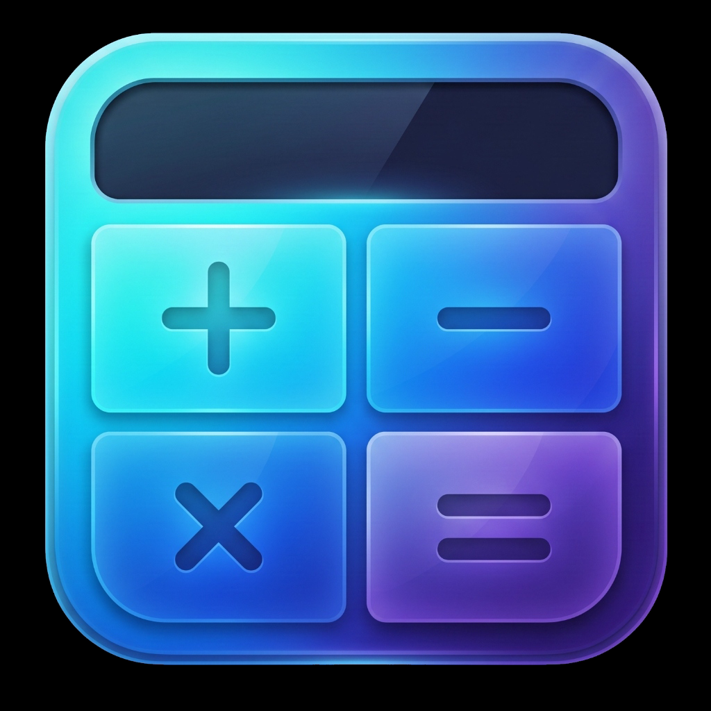
</p>

<h1 align="center">Calculator</h1>

<p align="center">
  <b>High-Precision Offline Calculation Engine & 150+ Specialized Scientific Tools</b><br />
  Built with Flutter & Dart for Android, Web, and Desktop.
</p>

<p align="center">
  <a href="https://github.com/rafayshhh/calculator/releases/tag/v1.0.0"></a>
  <a href="https://github.com/rafayshhh/calculator/releases/download/v1.0.0/Calculator-v1.0.0.apk"></a>
  <a href="https://flutter.dev"></a>
  <a href="https://dart.dev"></a>
  <a href="https://kreatekode.website"></a>
</p>

---

<p align="center">
  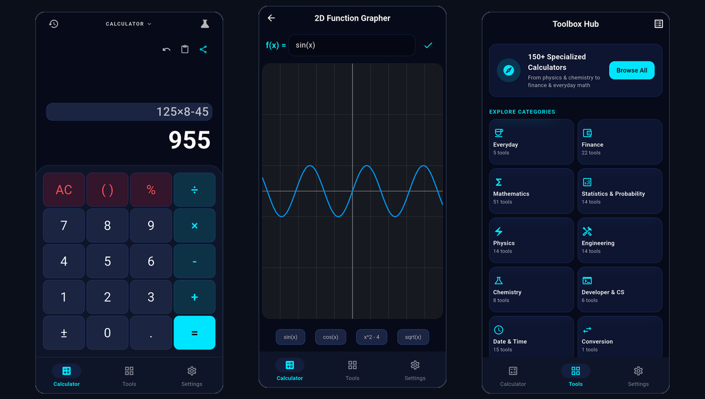
</p>

---

## 📱 Visual Showcase & Core Workspaces

### 1. Calculation Workspaces

| Standard Arithmetic | Scientific Keypad | 2D Function Grapher | Equation Solver |
| :---: | :---: | :---: | :---: |
| 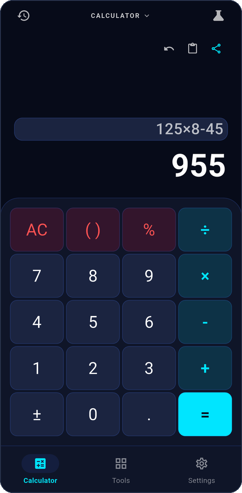 | 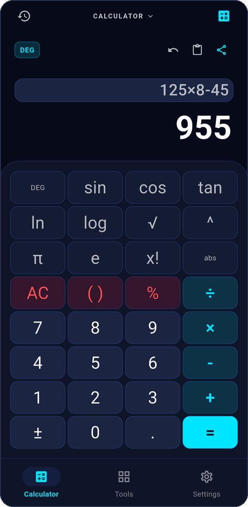 | 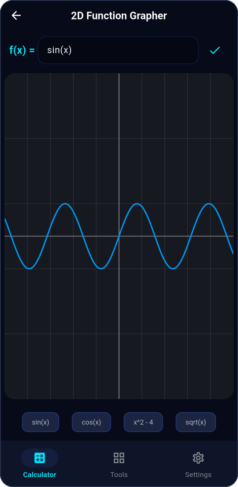 | 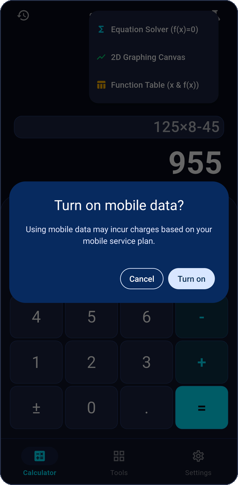 |
| **Instant Evaluation**<br />Dynamic parentheses, AST evaluation, and real-time history logging. | **Advanced Functions**<br />Trigonometric, logarithmic, radicals, constants ($\pi, e$), and factorials. | **Real-Time Plotting**<br />Cartesian coordinate canvas with pinch-to-zoom and preset functions. | **Step-by-Step Roots**<br />Linear, quadratic, and single-variable root resolution with dedicated keypad. |

---

### 2. Toolbox Hub & 150+ Specialized Calculators

| Toolbox Hub | 150+ Tools Directory | Tip & Bill Split | Compound Interest |
| :---: | :---: | :---: | :---: |
| 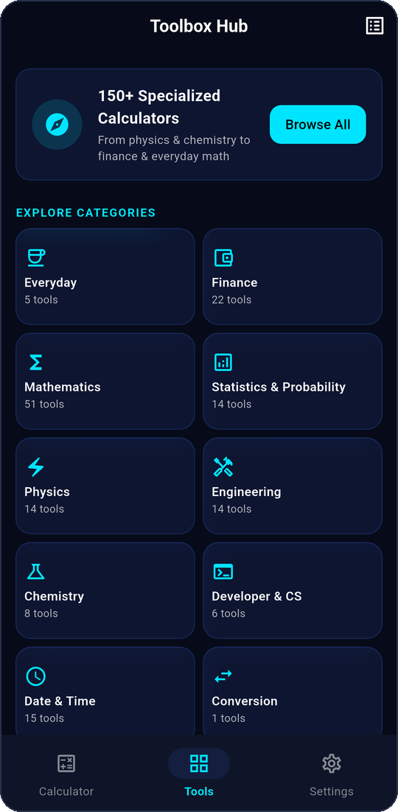 | 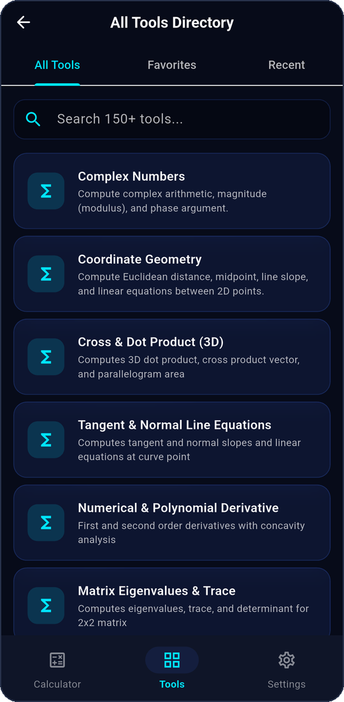 | 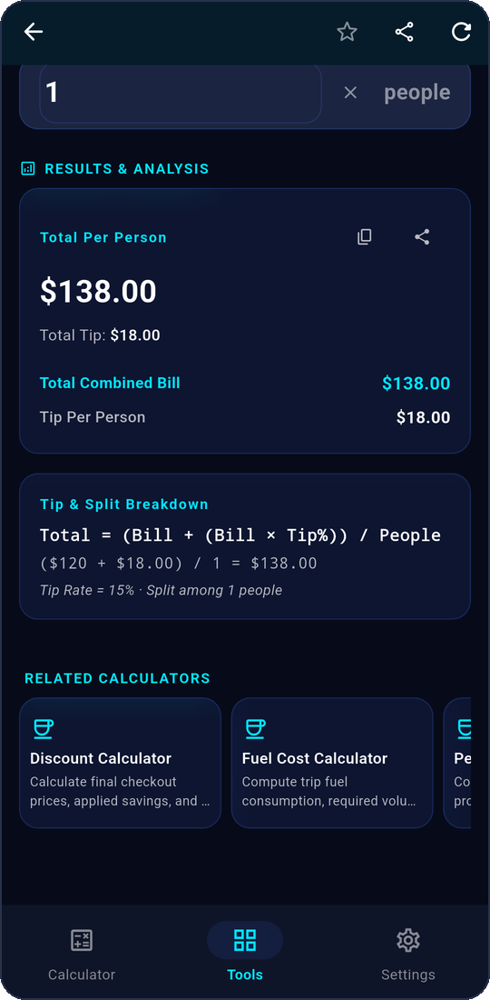 | 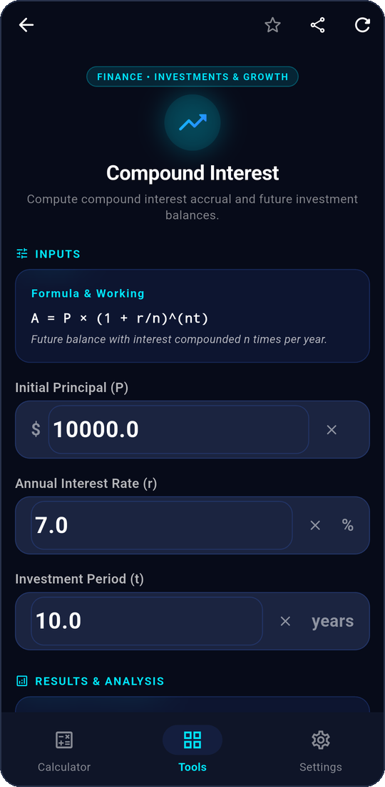 |
| **10 Domain Categories**<br />Finance, Math, Physics, Engineering, Chemistry, Developer, Everyday, Date/Time. | **Search & Filter**<br />Instant search across 150+ tools with Favorites and Recents tabs. | **Interactive Breakdown**<br />Tip rate chips, split dining checks, and formula breakdown cards. | **Financial Growth**<br />Principal, annual rate, compounding intervals, and final balance projections. |

---

### 3. Themes & Personalization

| Electric Cyan (Dark) | Clean Light Mode | Emerald Mint Palette | Settings & Publisher |
| :---: | :---: | :---: | :---: |
| 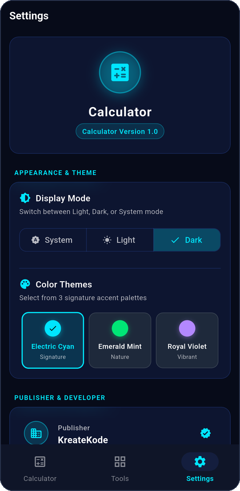 | 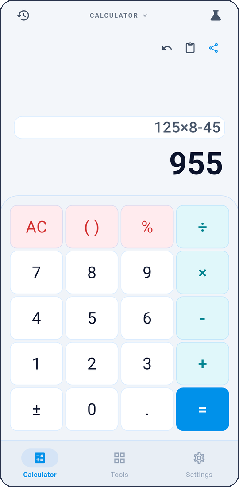 | 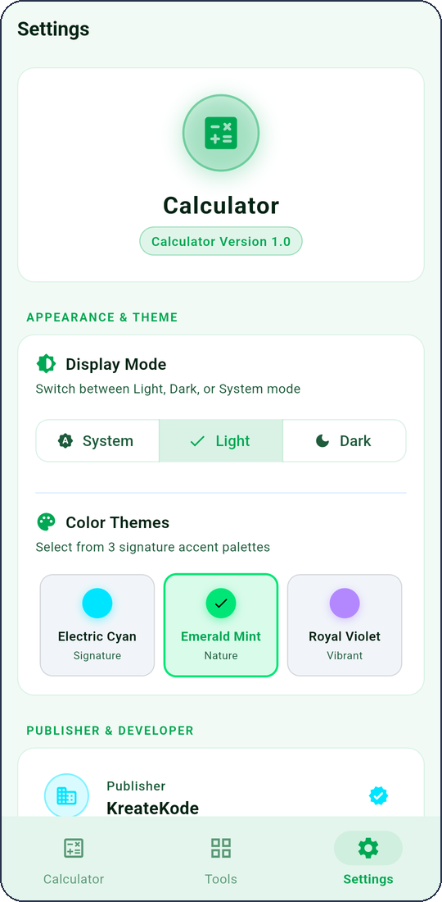 | 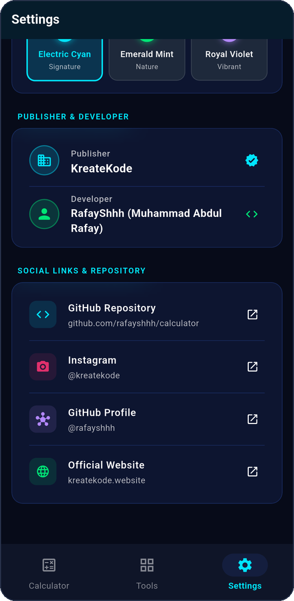 |
| **Signature Dark**<br />Deep OLED navy with glowing cyan accents and high readability. | **High-Contrast Light**<br />Edge-to-edge dark system overlay icons with clean pastel accents. | **Dynamic Accents**<br />Switch seamlessly between Electric Cyan, Emerald Mint, and Royal Violet. | **Verified Branding**<br />Version 1.0 badge, publisher credits, developer social links, and zero bloat. |

---

## 🌟 Comprehensive Feature Set

* **Advanced Mathematical Parser**: Custom pure-Dart lexer, recursive descent parser, and AST evaluator supporting implicit multiplication, trigonometric modes (DEG, RAD, GRAD), logarithms, powers, and percentages.
* **4 Core Calculation Workspaces**:
  * **Arithmetic Calculator**: Fast expressions evaluation with a morphing keypad.
  * **Equation Solver**: Linear, quadratic, and numerical root finding.
  * **Function Grapher**: Interactive $y = f(x)$ function plotting with pan and zoom.
  * **Function Table Generator**: Discrete interval step-evaluation.
* **150+ Specialized Mathematical & Scientific Tools**:
  * **Calculus & Analysis**: Derivatives, Definite Simpson Integration, Limits, Taylor Series, Root Bisection, Tangent & Normal Equations.
  * **Linear Algebra**: Eigenvalues & Trace, Matrix Inverse ($A^{-1}$), Gaussian Elimination Linear Systems, Vector Projection, 3D Cross/Dot Products.
  * **Geometry 2D & 3D**: SSS Triangle Solver, Circle/Sector, Regular Polygons, Spheres, Cylinders, Cones, Pyramids, Prisms, Tori, Conic Sections.
  * **Discrete Math & Number Theory**: Prime Factorization, Modular Inverses, Collatz $3n+1$, Fibonacci & $\phi$, Diophantine Equations, Euler's Totient, CRT, Boolean Gates.
  * **Mathematics & Statistics**: Matrices ($4\times4$), 2D/3D Vectors, Complex Numbers, Polynomials, Mean/Median/Mode, Variance, IQR, Z-Score CDF, Regression, Chi-Square.
  * **Finance**: Compound Interest, Amortized Mortgage, Loans & EMI, Savings Goals, ROI, CAGR, Margin & Markup, Break-Even, Sales Tax & VAT.
  * **Science & Chemistry**: Molar Mass, Stoichiometry, Molarity, Solution Dilution, Ideal Gas Law, Combined Gas Laws, Concentration, pH / pOH equilibrium.
  * **Physics & Mechanics**: Newton's Laws ($F=ma$), Kinematics, Momentum, Work & Energy, Density, Hydrostatic Pressure, Wave Speed, Projectile Motion, Gravitational Orbits.
  * **Electrical & Electronics**: Ohm's Law, Circuit Power, Series/Parallel Resistors, Voltage Dividers, LED Resistors, RC Time Constant, Inductors, Capacitors.
  * **Mechanical Engineering**: Torque, Gear Ratios, Mechanical Advantage, Hooke's Law, Stress & Strain, Young's Modulus, Efficiency, RPM.
  * **Everyday Calculators**: Discounts, Fuel Trip Costs, Unit Price Comparison, Percentage Variations.
  * **Date & Time**: Date Difference, Interval Addition, Age Breakdown, Business Days, Unix Timestamps, Duration Math.
  * **Developer**: Number Base Conversion (BIN/OCT/DEC/HEX), Bitwise Logic, Data Transfer Rates, Color Format Translation.
* **15-Category Unit Converter**: High-precision reciprocal unit conversions across Length, Mass, Temperature, Area, Volume, Speed, Time, Digital Storage, Energy, Pressure, Power, Fuel Economy, Angle, Frequency, and Data Rates.
* **Privacy-First & Offline-First**: 0 trackers, 0 network telemetry, 0 cloud dependencies. Persisted locally via Hive binary storage.
* **Responsive Multi-Platform**: Adaptive layout engine optimized for Mobile (<600dp), Tablet (600–899dp), and Desktop/Web (≥900dp).

---

## 🚀 Installation & Direct Download

### Android APK (Direct Install)
Download the latest signed release APK directly from GitHub Releases:
* 📦 **[Download Calculator-v1.0.0.apk](https://github.com/rafayshhh/calculator/releases/download/v1.0.0/Calculator-v1.0.0.apk)**

### Build from Source

#### Prerequisites
* Flutter SDK `3.13.0` or higher
* Dart SDK `3.13.0` or higher

```bash
# Clone the repository
git clone https://github.com/rafayshhh/calculator.git
cd calculator/"Calculator With Math Tools"

# Fetch dependencies
flutter pub get

# Run on connected Android device
flutter run -d android

# Run on Web (Chrome)
flutter run -d chrome

# Run on Desktop (Windows / macOS / Linux)
flutter run -d windows
```

### Running Test Suite
```bash
flutter test
```
*Current test suite: **234 / 234 passing (100%)** with **0 static analysis warnings**.*

---

## 🏗️ Architecture & Tech Stack

* **UI Framework**: Flutter (Material 3 with custom adaptive token system)
* **Language**: Dart (strict null-safety)
* **State Management**: Flutter Riverpod (`flutter_riverpod`)
* **Routing**: GoRouter (`go_router`) with deep linking & state serialization
* **Local Storage**: Hive (`hive_flutter`) binary storage
* **Mathematical Engine**: Custom Pure-Dart AST (zero external calculation dependencies)

---

## 📖 Documentation Reference

Comprehensive architectural blueprints and developer references are maintained in the [`Documentation/`](Documentation/) directory:

* [System Architecture](Documentation/ARCHITECTURE.md)
* [Tools & Formulas Reference](Documentation/TOOLS_REFERENCE.md)
* [Development & Contributor Guide](Documentation/DEVELOPMENT_GUIDE.md)
* [Testing Guide](Documentation/TESTING_GUIDE.md)
* [Open Source Roadmap](Documentation/OPEN_SOURCE_ROADMAP.md)
* [Security Policy](Documentation/SECURITY.md)
* [Project Status & Verification](Documentation/PROJECT_STATUS.md)

---

## 👤 Publisher & Creator Credits

* **Publisher**: **KreateKode**
* **Developer**: **Muhammad Abdul Rafay** ([@rafayshhh](https://github.com/rafayshhh))
* **Official Website**: [kreatekode.website](https://kreatekode.website)
* **GitHub Profile**: [github.com/rafayshhh](https://github.com/rafayshhh)
* **Instagram**: [@kreatekode](https://www.instagram.com/kreatekode/)
* **Google Play Store**: [KreateKode Apps](https://play.google.com/store/apps/developer?id=KreateKode)
* **Repository**: [github.com/rafayshhh/calculator](https://github.com/rafayshhh/calculator)
